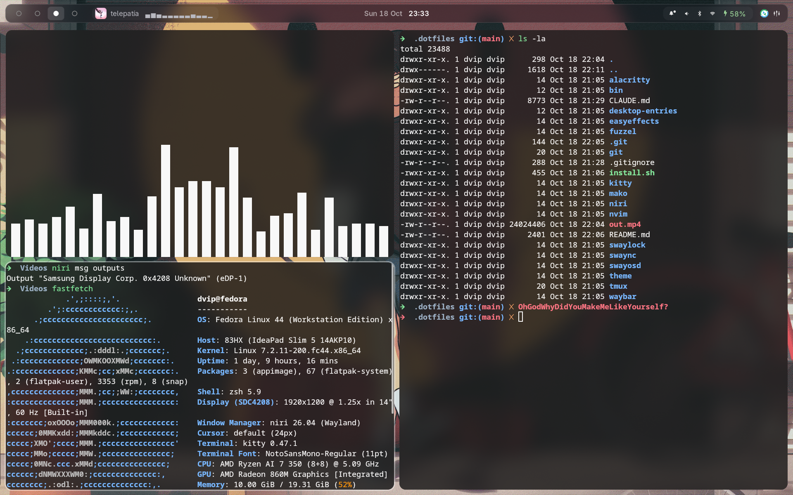
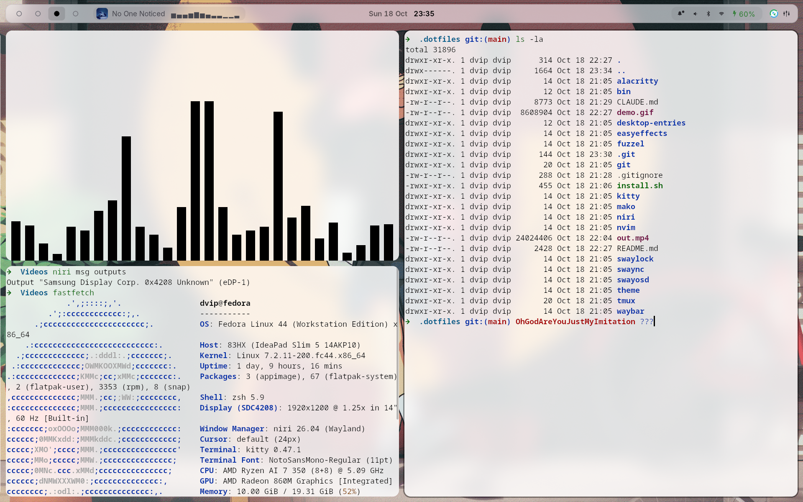
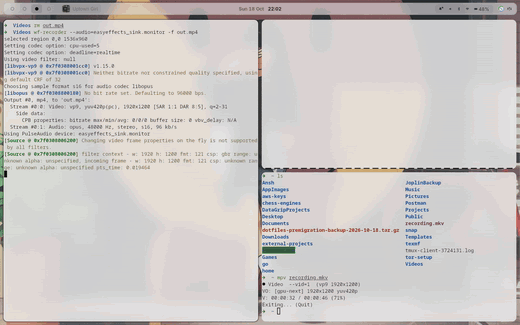

# dotfiles

| Dark | Light |
|:---:|:---:|
|  |  |

Managed with [GNU stow](https://www.gnu.org/software/stow/). Every top-level folder is a
**package** that mirrors the layout of `$HOME`, e.g. `niri/.config/niri/config.kdl` is linked to
`~/.config/niri/config.kdl`. The real files live here, so `git` tracks every change.

```sh
cd ~/.dotfiles
./install.sh                # link everything      (= stow -t ~ -R <every package>)
./install.sh niri waybar    # link only some
stow -D -t ~ waybar         # unlink one package (files stay in the repo)
git status / git diff       # see what changed in any package
```

To add a new tool: move its config into `~/.dotfiles/<tool>/<same path as under $HOME>`,
then `./install.sh <tool>`.

## Packages

| Package | What |
|---|---|
| niri, quickshell, fuzzel, swaylock | the desktop. **quickshell** is the bar, quick settings, date menu + notifications (it is the notification daemon), OSD, media sheet and polkit prompt |
| waybar, swaync, swayosd | the previous bar / notifications / OSD, kept but no longer started |
| theme | central theming (`theme.toml`, templates, the `theme` engine): see `theme/.config/theme/README.md` |
| kitty, alacritty, tmux | terminals and multiplexer |
| nvim | **its own git repo** (`dvip1/nvim-config`), only linked here, not tracked by this repo |
| bin | my scripts in `~/.local/bin` (theme, setwall, bt-menu, wifi-menu, clip-menu, win-menu, shortcuts; idle + power for locking/suspend; lockscreen = swaylock with IR face unlock via Visage, see `~/Projects/face_detection/docs`) |
| desktop-entries | launcher entries for those scripts (they hold absolute `/home/dvip/...` paths) |
| git, easyeffects, mako | misc |


